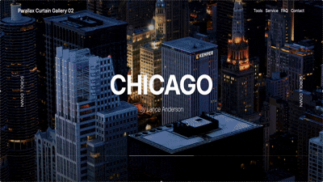

# Parallax Snap Album

A full-screen photo album with a scroll-driven curtain reveal and a subtle parallax effect. Each scroll, swipe or key press wipes the next photo into view while the photos drift past each other for a sense of depth. Built with plain JavaScript and Tailwind CSS, with no animation libraries.



**Live demo:** [check out the live demo](https://shalizsharafi.github.io/Parallax-Curtain-Gallery-JavaScript/)

## Features

- **Curtain reveal:** photos are stacked and revealed with an animated `clip-path` wipe.
- **Parallax depth:** the incoming and outgoing photos move in opposite directions during the transition.
- **Wheel, keyboard and touch input:** mouse wheel, arrow keys, and swipe gestures on mobile.
- **Animated header counter:** the photo number slides in sync with the scroll.
- **Progress line:** a bar that grows with the current photo and adapts to the number of photos.
- **Animation lock:** input is ignored while a transition is running, so fast scrolling never breaks the sequence.

## How it works

Everything is driven by a single eased progress value from 0 to 1, calculated every frame with `requestAnimationFrame`. That one number controls:

- the `clip-path` inset that reveals the next section,
- the `translateY` offset of both photos (the parallax),
- the sliding header counter and the center title,
- the width of the progress line.

Every input method (wheel, keys, touch) calls the same `goTo(index)` function, which clamps the target index to the valid range, records the section being left and the one being entered, and starts the animation. A custom cubic ease-in-out function shapes the motion.

## Built with

- HTML5
- Tailwind CSS v4
- Vanilla JavaScript (no libraries)

## Run it locally

```bash
git clone https://github.com/your-username/parallax-snap-album.git
cd parallax-snap-album
```

Open `index.html` in your browser. If you want to edit the styles, run the Tailwind build or watch command from your setup so `out.css` is regenerated.

## What I learned

- Driving several animations from one shared progress value
- Animating `clip-path` and `transform` with `requestAnimationFrame`
- Writing custom easing functions
- Handling wheel, keyboard and touch events through one shared function
- Using `dvh` units for full-screen layouts on mobile browsers

## Possible improvements

- Load the photos from a data array instead of hard-coded HTML
- Make the nav links jump to a specific photo
- Respect `prefers-reduced-motion`
- Add photo captions and locations
